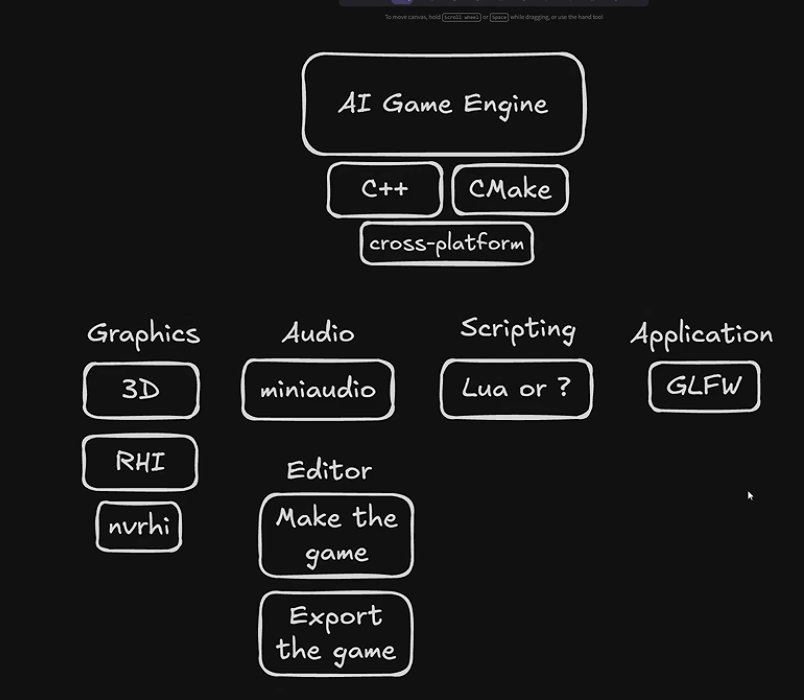
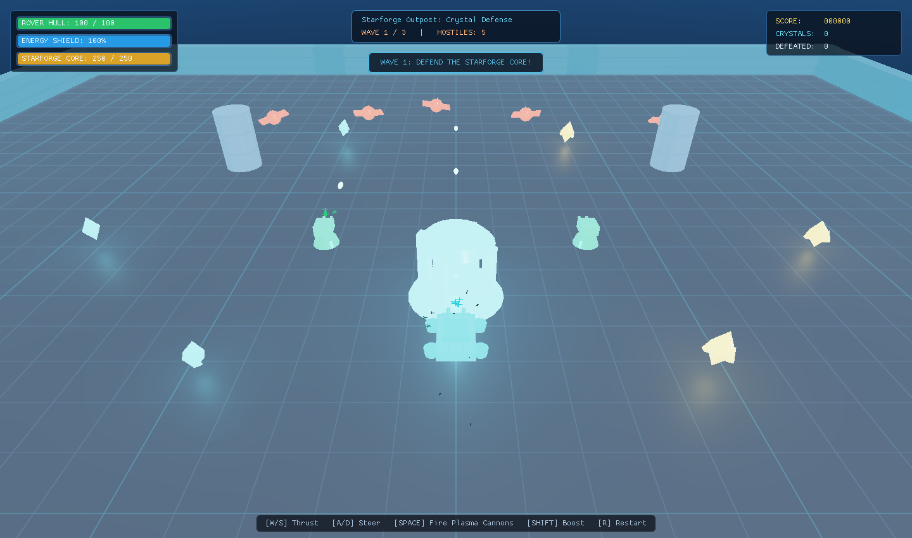
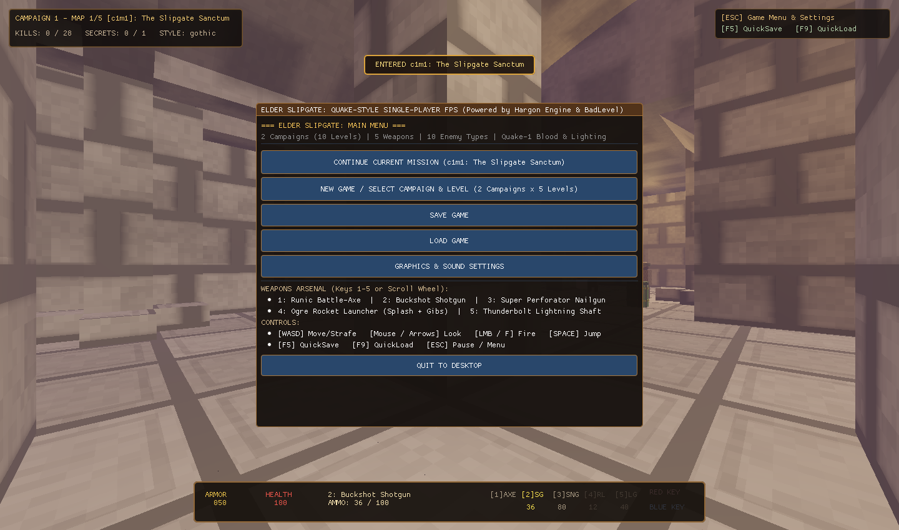
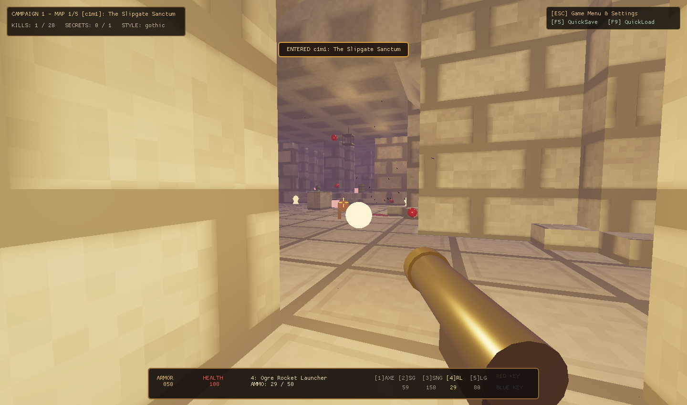
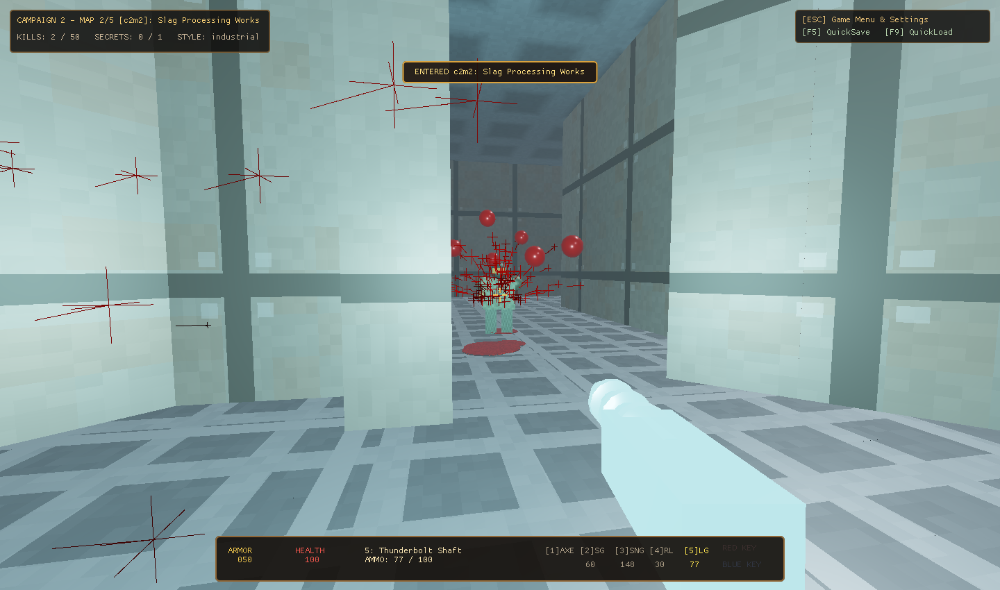
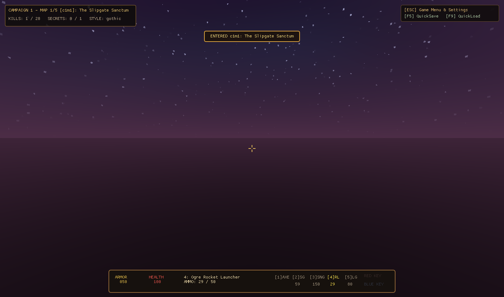
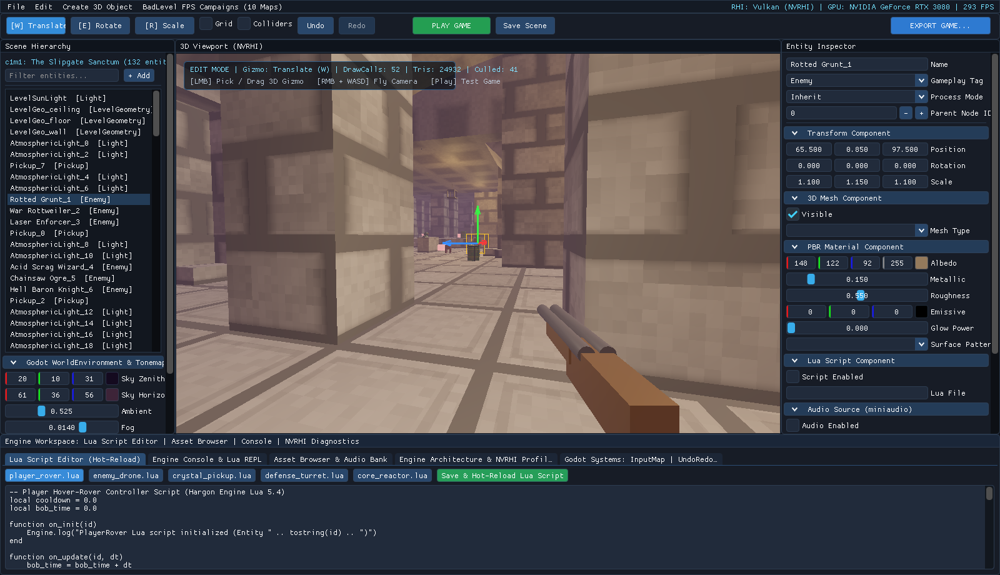
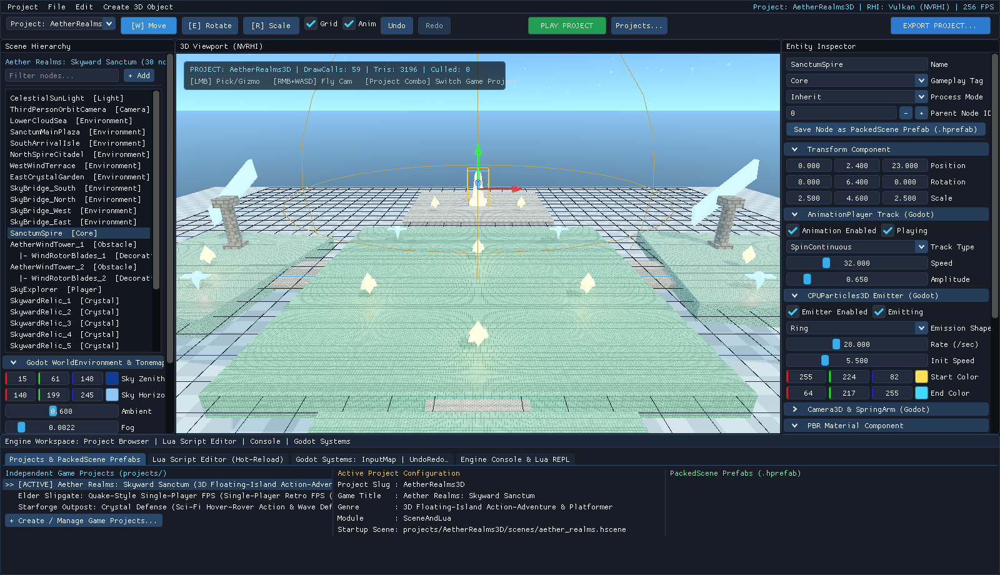
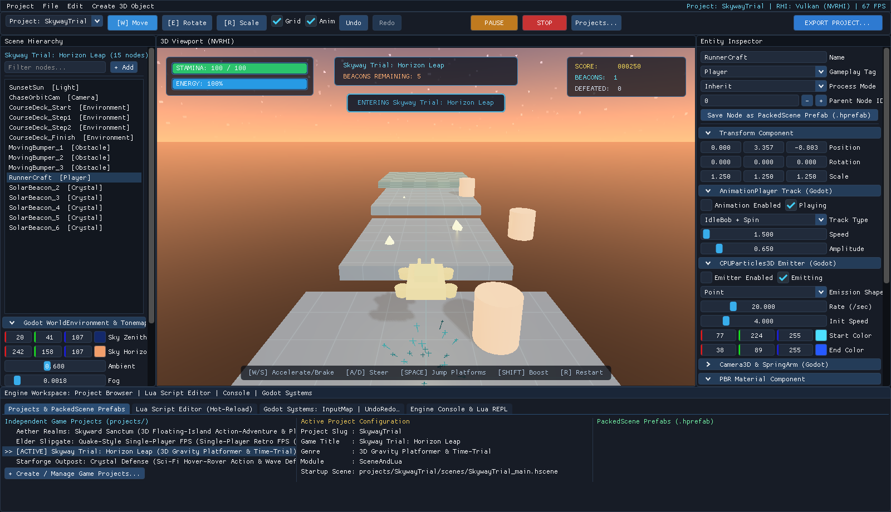
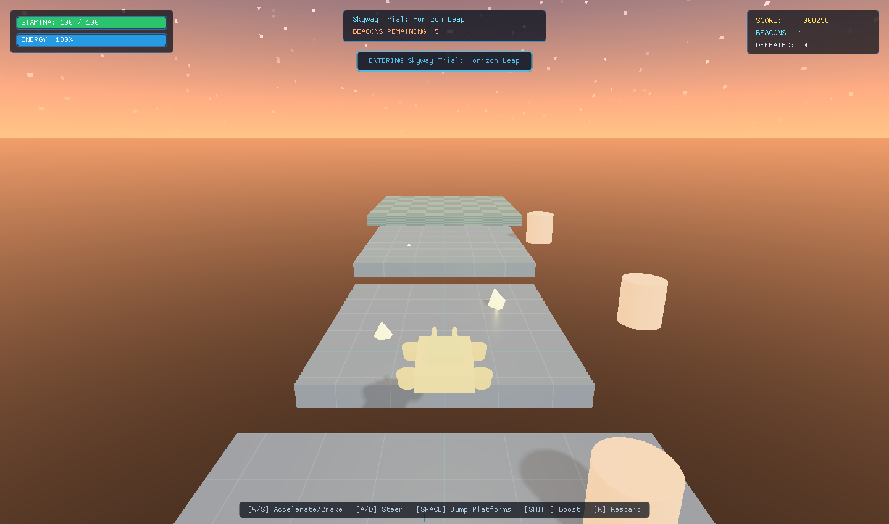

# The Hargon Engine Devlog
### *Or: How a Back-of-a-Napkin Sketch Accidentally Grew a Quake-Style Shooter, Turned the Menus Upside Down, Vanished Into Outer Space, and Finally Learned Some Manners*

*(With occasional unsolicited commentary from **Uncle Wispr**, who insists his brass ear trumpet receives telemetry directly from the GPU.)*

---

## Chapter 1: It Started With Seven Boxes and a Question Mark

Every respectable catastrophe begins with a drawing that makes everything look easy.

In the beginning, there was no code, no 3D world, and no screaming monsters — just a dark whiteboard sketch with rounded rectangles, hopeful labels, and one gloriously honest admission right in the scripting box:

> **Scripting:** *"Lua or ?"*

On paper, the whole plan looked like ordering lunch: build a 3D engine from scratch in C++, glue together a graphics layer, add sound, pick a scripting language *(preferably before the question mark gets philosophical)*, put a visual editor on top so someone can *"Make the game"* and *"Export the game,"* and — most importantly — **don't stop at spinning cubes**. Actually ship a playable game.

Uncle Wispr squinted at the whiteboard for a full minute, tapped his ear trumpet twice, and nodded solemnly.

> *"Ah, yes,"* said **Uncle Wispr**. *"A cross-platform gargoyle engine with mini-ravioli and a button that says 'deport the game.' Very sensible. Put two scoops of cinnamon in the physics box before it overheats."*

Nobody corrected him. There was too much typing to do.

---

## Chapter 2: Teaching a Blank Window Which Way Is Up (The Ceiling Incident)

Once the very first pile of engine code finally agreed to compile, we hit our first historic triumph: we launched the brand-new **Hargon Editor**, took a celebratory screenshot, opened it eagerly... and discovered that **every single menu, button, and Inspector panel was completely upside down.**

Strangely, the 3D viewport sitting *inside* those upside-down panels was completely right-side up.

Imagine sitting in a café where the chairs are bolted to the ceiling, your coffee is politely sitting right-side up on a coaster, and the waiter cheerfully hands you a menu you have to read while doing a handstand. That was Version 0.1 of Hargon Editor.

What happened? Two well-meaning pieces of rendering math were trying to be helpful at the exact same time. Our modern graphics driver (Vulkan) natively treats screen coordinates upside down compared to Windows graphics, so it quietly flipped the screen vertically behind the scenes to be polite. Meanwhile, our UI menu renderer hadn't gotten the memo and flipped the menu math *again* to "help" Vulkan. Two helpful flips multiplied together equaled one **File menu hanging from the rafters**.

One removed minus sign later, gravity returned to the buttons, the hover-rover stopped looking like a bat, and **Starforge Outpost: Crystal Defense** roared to life: a real playable 3D sci-fi arena where you pilot a hover-rover, dodge angry drones, fire plasma cannons alongside automated turrets, and protect a glowing reactor core.

Even better: clicking **Export** genuinely packaged it into a standalone playable game that ran outside the editor on the first try. We had officially cleared the "not just a spinning cube" bar.

---

## Chapter 3: "Now Make a Whole Quake-Style Shooter (Without Touching the Dungeon Box)"

Just as Starforge Outpost caught its breath, the next marching order arrived:

Take **BadLevel** — an external procedural level generator lying in the corner under strict diplomatic immunity (*"do not change a single hair on its head!"*) — and build a **full single-player 90s-inspired FPS** using Hargon Engine:
- Textured dungeon levels
- 5 distinct weapons
- 10 enemy types
- 2 full 5-level campaigns
- Moody lighting & Quake-1-style blood spatter and gibs
- Decorations, main menu, graphics/sound settings, and Save/Load slots

Reader, we went slightly feral in the best possible way.

Out popped **Elder Slipgate**: ten levels across two campaigns (*Gothic Sanctum* realms and *Industrial Slag* refineries), armed with a Runic Battle-Axe, Double-Barrel Shotgun, Super Nailgun, Rocket Launcher, and Thunderbolt Lightning Shaft, populated by Rotted Grunts, War Rottweilers, Chainsaw Ogres, Hell Barons, and Shambler Horrors — plus flickering lights, hanging lanterns, barrels, keys, quick-saves (`F5`/`F9`), and an absurdly satisfying Quake-style fountain of chunky red pixels whenever a rocket landed square on a Laser Enforcer's forehead.

Uncle Wispr watched ten seconds of Campaign 2 through his spectacles and clapped his hands.

> *"Marvelous!"* **Uncle Wispr** shouted over the shotgun blast. *"Finally, a wholesome gardening simulator! Look at all those lovely red tomatoes bursting out of the mechanized plumbers!"*

Everything worked. The FPS ran smoothly at crisp framerates, you could save mid-firefight and reload later, and the levels actually felt moody and atmospheric.

There was only one tiny, shameful architectural secret hidden behind the curtain...

---

## Chapter 4: The Void Incident & Studying at the Church of Godot

Before messing with anything sacred, we stuffed the entire working v1 source code into a digital storm cellar (`backups/`), opened up the source code of **Godot Engine** like wide-eyed apprentices touring a master clockmaker's workshop, and started taking notes.

Look at all the clever tricks Godot uses that Hargon hadn't even dreamed of yet:
1. **AgX Tonemapping & World Environment controls** so bright lasers glow instead of flattening into neon cardboard.
2. **Fast Frustum Culling** so the graphics card stops painstakingly drawing statues standing 200 feet behind your back.
3. **Node Trees & `PackedScene` Prefabs** so a Wind Tower's spinning blades actually stay bolted onto the tower when you drag the tower across the yard.
4. **An `InputMap`, `Tween` animator, Undo/Redo history, `ProcessMode` pausing, and `SpringArm` cameras** that pull closer instead of burying the camera lens inside stone walls.

Naturally, while rewiring the shader plumbing to add Godot-style environment lighting and fog, we forgot one tiny detail: we compiled our upgraded 3D shader without giving it Vulkan's secret locker-number translation sheet (`-fvk-b-shift 256 0...`).

What happened when we booted the game?

Every wall, every floor tile, every monster, every pillar, and our hero's own rocket launcher **instantly evaporated into nothingness.** Yet the game's Heads-Up Display cheerfully carried on as if everything were fine:

> *`ARMOR 050 | HEALTH 100 | 4: Ogre Rocket Launcher | ENTERED c1m1: The Slipgate Sanctum`* — floating serenely in the middle of deep outer space.

That screenshot deserves a frame on the studio wall. The HUD genuinely had no idea the universe had been deleted underneath its boots. Once the compiler received its Vulkan register-shift map again, an entire gothic fortress materialized out of nowhere in a single frame.

Even better: **Undo and Redo** arrived in the editor, **AgX filmic lighting** bathed scenes in warm sunlit color, **Prefabs** worked, and we added a third world — **Aether Realms: Skyward Sanctum** — to prove Hargon could render bright floating islands, wind turbines, and glowing spires too.

---

## Chapter 5: The Great Divorce (Why Does My Peaceful Island Editor Have a "BadLevel FPS Campaigns" Menu?!)

Then came the moment of painful honesty.

Take a close look at our Visual Editor right after all those improvements landed:

Look at the very top menu bar of the supposedly "general-purpose" game engine editor:

> `File   Edit   Create 3D Object   BadLevel FPS Campaigns (10 Maps)`

And worse: inside the engine's own core code and standalone runtime, **Elder Slipgate** was baked straight into the foundation! If you launched the runtime without parameters, it didn't ask what game you wanted to play — it practically shoved a double-barrel shotgun into your hands and kicked you down the Slipgate stairs whether you wanted to play a sci-fi rover game, a floating island adventure, or a peaceful physics sandbox.

That simply had to stop. Reusable systems belong in the **engine**; game-specific rules belong inside **individual game projects**.

So we performed open-heart surgery:
1. **Evicted Elder Slipgate** cleanly out of `engine/`, `editor/`, and `runtime_app/` into its own independent project folder (`projects/ElderSlipgate/`), connected via a clean plug-in gameplay module interface — preserving all 10 maps, 5 weapons, 10 enemy species, blood splatters, and Save/Load intact.
2. **Removed hardcoded game names** ("PlayerRover", "StarforgeOutpost", "SanctumSpire") from the core runtime and serializer, switching gameplay queries to clean generic tags and data-driven HUD labels stored in each scene file.
3. **Turned BadLevel into an optional engine bridge**, untouched inside `external/BadLevel`, so *any* project can opt into procedural dungeon tools without forcing non-FPS games to drag 10 dungeon maps around in their pockets.
4. **Built a proper Project Manager & Interactive Runtime Launcher**: launch `HargonRuntime` alone and it politely shows a Project Chooser instead of ambushing you with a rocket launcher. Launch `HargonEditor` and you can create, open, switch, play, and export completely unrelated games — each getting its own clean export folder.

Look at the top bar now: `Project   File   Edit   Create 3D Object` — clean, calm, and zero unsolicited chainsaw ogres!

---

## Chapter 6: Learning Gravity, Making Shadows, and Jumping Across the Clouds (*Skyway Trial*)

With Hargon finally acting like a real general-purpose engine instead of three FPS hacks in a trench coat, it was time to push the engine's actual capabilities forward — again borrowing wisdom from Godot:

1. **Real 2048×2048 Directional Shadows (PCF Soft Filtering)**:
   Until now, hover-rovers, pillars, and dungeon monsters glided around without casting a single shadow on the ground beneath them — which always gave scenes that faint *"photoshopped onto a tabletop"* vibe. Now the sun casts smooth, texel-snapped real-time shadows across floors, platforms, walls, and columns!
2. **Real 3D Physics Shapes, Collision Layers, Raycasting & Platform Grounding**:
   Previously, our physics engine had a funny secret: it pretended every rectangular floor deck was actually a squishy sphere! Try standing on top of an elevated bridge when the engine thinks the bridge is a beach ball. We rewrote the collision math to handle true 3D boxes, spheres, 32-bit layer/mask filters, genuine 3D raycasts (`SpringArm3D` third-person cameras now pull inward smoothly instead of clipping into walls!), and `is_on_floor` detection so characters can leap between vertical platform heights under gravity.
3. **32-Voice Spatial Audio Pool & Godot-Style Timers**:
   Sounds now fade naturally over distance using inverse-distance, inverse-square, or logarithmic curves with subtle random pitch variation so twenty identical footsteps don't sound like an angry typewriter. And Lua scripts gained named countdown timers (`create_timer` / `is_timer_ready`).

> *"Shadows?!"* cried **Uncle Wispr**, squinting at his boot through his ear trumpet. *"Nonsense! I put directional shallots on all my baked potatoes, and none of them have ever fallen off the floor!"*

To prove Hargon truly supports completely different genres now — *without a single goblin, shotgun, or BadLevel file in sight* — we created a brand-new unrelated project from scratch using Template #4: **Skyway Trial: Horizon Leap**, a sunny **3D Gravity Platformer & Time-Trial**.

You pilot a golden craft across stepped skyway platforms hovering over a warm sunset horizon, steer around sweeping bumpers, hit `Space` to launch off edges using live gravity and `is_on_floor` physics, collect floating Solar Beacons, and respawn at platform checkpoints if you overshoot into the cloud sea.

Look closely at the screenshot from the **standalone exported `SkywayTrial.exe`** below — completely separate from HargonEditor and completely free of Elder Slipgate: our craft just launched off the starting deck, cleared the gap, landed cleanly on the elevated `CourseDeck_Step1` platform, and is casting its own crisp real-time shadow onto the deck right beneath its wheels!

*(Meanwhile, `ElderSlipgateFPS.exe` still launches straight into Campaign 1 & 2, switches weapons, saves and loads cleanly, and splatters Imp blood across the floor with zero complaints — and its standalone export doesn't share a single scene or binary dependency with `SkywayTrial.exe`.)*

---

## Honest Confessions & What's Missing (So Far)

A devlog that pretends everything is finished forever is lying to you, so here is where things genuinely stand today:
- **History disclaimer**: Everything in this diary happened across real recorded commits, builds, screenshots, and logs — no bugs were embellished for dramatic flair (though the ceiling-mounted File menu really did require staring at a Vulkan coordinate helper for ten minutes in disbelief).
- **Platform reality check**: While Hargon uses cross-platform libraries (`CMake`, `C++20`, `GLFW`, `NVRHI Vulkan`, `miniaudio`, `Lua`), only the **Windows (MSVC + Vulkan / D3D11, tested on RTX 3080)** build has actually been compiled, played, and visually verified in this repository so far. Linux and macOS remain untested on real hardware.
- **Shadows & Models**: Our directional shadow pass currently renders one crisp 2048×2048 cascade tracking near the camera rather than multi-cascade sun shadows, and animated character rigs still rely on parametric/composite primitives and `.obj` meshes rather than full GLTF skeletal bone skinning.
- **Editor conveniences**: You can create projects, edit hierarchies, inspect components, write/hot-reload Lua scripts, place prefabs, and export standalone executables — though a visual 3D asset drag-and-drop shelf and visual material graph are still wish-list items for future chapters.

---

## To Be Continued...

This devlog isn't a tombstone — it's an open notebook. Every major new feature, architectural breakthrough, bizarre rendering accident, and Uncle Wispr pronouncement gets its next chapter right here as Hargon Engine grows.

*(Want the dry, jargon-filled developer manual instead? Head over to [README.md](README.md) — **Uncle Wispr** promises not to follow you there.)*
